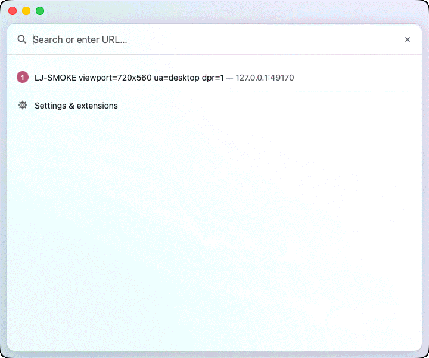
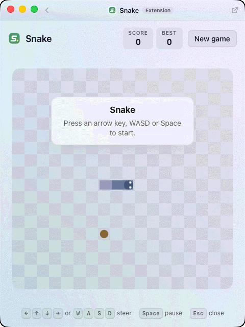
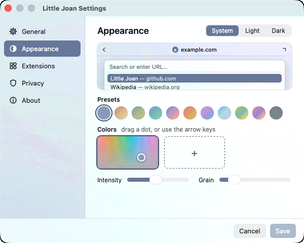
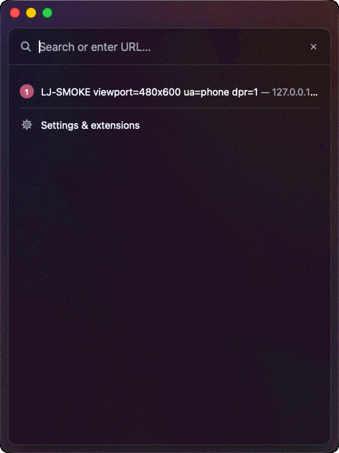
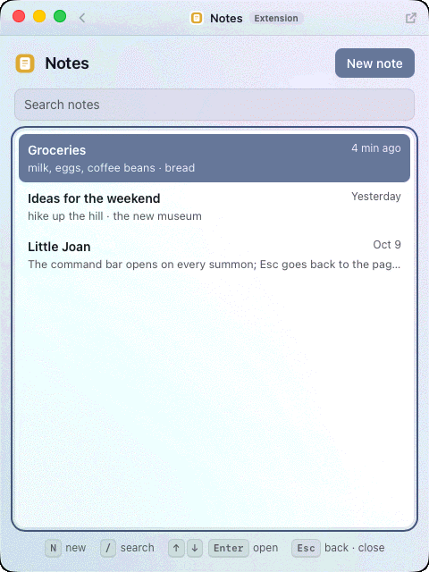
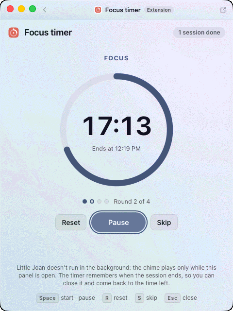

# Little Joan

[](https://github.com/memoliertorerr/LittleJoan/actions/workflows/ci.yml?query=branch%3Amain)
[](LICENSE)
[](https://github.com/memoliertorerr/LittleJoan/releases/latest)

A tiny pop-up browser for Windows, Linux, and macOS that stays out of the way until you call it.

Little Joan waits in the tray or menu bar with no page loaded. Press a global keyboard shortcut and
a small, resizable window appears at once with its command bar open, ready to type. Type an
address or a search, press Enter, and the page fills the window. Close it and the page is thrown
away — nothing of a site keeps running in the background. By default Little Joan **stays ready**
after closing: it keeps its hidden window and command bar so the next summon is instant, which
holds some memory while closed (in CI about 30 MB more than Hibernate on macOS, 110 MB on Windows,
200 MB on Linux). If you'd rather it hold as little as possible, choose **Hibernate** in Settings →
General → After closing (or "Stay ready for 15 minutes", which hibernates after that).

It uses the web engine your system already has (WebView2 on Windows, WebKit on macOS,
WebKitGTK on Linux), which keeps the download to a few megabytes.

Inspired by Little Arc in the Arc browser. Little Joan is an independent project and is not
affiliated with or endorsed by The Browser Company.

<p align="center">
  
  
</p>
<p align="center"><sub>Screenshots from the CI smoke test on macOS (its test page and sample data only).</sub></p>

> **Status:** [v0.2.0](https://github.com/memoliertorerr/LittleJoan/releases/tag/v0.2.0) is the
> latest release — start at login and a first-launch welcome, the Little Arc-style command bar and
> toolbar, logins that survive closing, local history, themes, extensions (experimental) with
> twelve bundled ones, smooth resizing, phone or desktop per site, quick commands, keys of your
> own, downloads, page zoom, the shortcut under Wayland, and Linux ARM64 builds (the
> [changelog](CHANGELOG.md) has everything, and the known issues). Every build is smoke-tested in
> CI on all three systems (Linux: the `.deb` on Ubuntu 24.04 and 22.04 and the AppImage on 24.04,
> on x86_64 and ARM64); none is code-signed yet. See the known issue under Fullscreen video.
> The [v0.2.1-beta.1 pre-release](https://github.com/memoliertorerr/LittleJoan/releases/tag/v0.2.1-beta.1)
> opens instantly: it stays ready after you close it (or hibernates, your choice in Settings), and
> opens over full-screen apps on the Space you are on.
> The build plan and progress tracker live in
> [docs/BUILD_PLAN.md](docs/BUILD_PLAN.md).

## Install

Download the installer for your system from the
**[latest release](https://github.com/memoliertorerr/LittleJoan/releases/latest)** — v0.2.0, with
the file names below. The builds aren't code-signed yet, so the first launch shows a warning; the
steps below get past it.
(Development builds of every change are also kept as artifacts of the
[CI workflow](https://github.com/memoliertorerr/LittleJoan/actions/workflows/ci.yml).)

- **Windows 10/11 (x64):** `LittleJoan-0.2.0-windows-x64-setup.exe` (about 2 MB). It
  installs for your user only, no admin needed. Windows SmartScreen may warn about an unknown
  publisher: choose **More info → Run anyway**. Windows 10 without the WebView2 runtime gets it
  during setup.
- **macOS 12.3 or later (Intel or Apple silicon):** `LittleJoan-0.2.0-macos-universal.dmg`
  (about 5 MB). Open it and drag Little Joan to Applications. It isn't notarized, so macOS
  blocks the first launch. Either run this once:

  ```bash
  xattr -dr com.apple.quarantine "/Applications/Little Joan.app"
  ```

  or try to open the app, then click **Open Anyway** in **System Settings → Privacy &
  Security**. (Right-click → Open no longer gets past this on macOS 15 and later.) Little Joan
  lives in the menu bar, with no Dock icon.
- **Linux (x86_64):**
  - Debian/Ubuntu (Ubuntu 22.04 or later, Debian 12 or later):
    `sudo apt install ./LittleJoan-0.2.0-linux-amd64.deb` (about 3 MB; it pulls in the
    system's WebKitGTK and the GStreamer plugins that video needs). On Ubuntu 22.04 a video
    can't go fullscreen (see Fullscreen video).
  - Elsewhere, on a distribution with glibc 2.39 or later (Ubuntu 24.04+, Debian 13, Fedora 40+
    and other current ones): `chmod +x LittleJoan-0.2.0-linux-x86_64.AppImage` and run it
    (about 160 MB; it carries its own WebKitGTK 2.52 and media framework, so fullscreen video
    works wherever it runs). Older systems: use the `.deb`.
  - The tray icon needs an AppIndicator host (on GNOME, the "AppIndicator and
    KStatusNotifierItem Support" extension).
- **Linux (ARM64 / aarch64)** — new in v0.2.0: the same two downloads, built on ARM, for ARM
  machines such as Ubuntu in a virtual machine on an Apple silicon Mac.
  - Debian/Ubuntu (Ubuntu 22.04 or later, Debian 12 or later):
    `sudo apt install ./LittleJoan-0.2.0-linux-arm64.deb` (about 3 MB). As on x86_64, on
    Ubuntu 22.04 a video can't go fullscreen.
  - Elsewhere, with glibc 2.39 or later: `chmod +x LittleJoan-0.2.0-linux-aarch64.AppImage`
    and run it (about 150 MB; it carries its own WebKitGTK 2.52 and media framework).
  - The tray icon needs an AppIndicator host, as above.
- **Check a download (optional):** each release includes `SHA256SUMS.txt`. Run
  `shasum -a 256 -c SHA256SUMS.txt --ignore-missing` in the download folder on macOS or Linux, or
  compare against `Get-FileHash <file>` on Windows.

The very first launch opens the window once with a short welcome: the shortcut, where the icon
is, and a "Start Little Joan at login" checkbox. Every launch after that only shows the tray /
menu-bar icon (and, unless you chose Hibernate, readies its hidden window a few seconds later, so
even the first summon is instant). To have the shortcut ready after every restart, turn on
**Start Little Joan at login** (in the welcome or in Settings; it's off until you do). On macOS,
move Little Joan to Applications first: an app opened straight from the disk image or from
Downloads runs from a temporary copy, so Little Joan won't add a login item for it.

## Using it

- **Summon:** press **Ctrl+Shift+Space** (Windows, Linux) or **Cmd+Shift+Space** (macOS), or
  choose **Open Little Joan** in the tray menu. The window opens with the **command bar** over
  it: type an address or a search and press Enter. It opens where you are — on the current
  desktop or Space, and over an app that is full screen — and goes behind other windows when you
  click them, like any window.
- **The command bar** suggests as you go. With nothing typed it shows the sites you open most
  (until there is some history: Wikipedia, YouTube, GitHub and Google Maps). As you type: the
  best match from your history — and when what you type starts a site's address, the address is
  completed in the field (Tab accepts it) —, a search with your search engine, then more matches.
  ↑/↓ choose a row, Enter opens it (with no row chosen, Enter opens what you typed), Shift+Delete
  removes a page from your history, × or Esc closes the command bar. Typing "history" (or just
  "hi") offers **History**; "settings" (or "preferences", "options") offers **Settings**; "quit"
  (or "exit") offers **Quit Little Joan**. The last row, **Settings & extensions**, opens Settings
  on its Extensions tab.
- **Quick commands** in the command bar, each showing how things are now — type a word and pick
  the row with ↓ and Enter:
  - on a page: **Translate page**, **Open in browser**, **Copy link**, **Copy as Markdown link**,
    **Reload**, and Desktop site / Phone site / Automatic for the site;
  - **Theme: System / Light / Dark** and **Theme: Sand**, **Dusk**… (the presets; the current one
    marked ✓), **Search with Google / DuckDuckGo / Bing / Brave** (✓), **Mobile sites — on/off**,
    **Remember history — on/off**, **Start at login — on/off**, **Icon — shown/hidden**;
  - **Clear history** (last hour, 24 hours, 7 days, everything — press Enter twice; Esc cancels),
    **Settings → Appearance / Extensions / Privacy / About**, **Reload extensions**.

  Settings you change this way are saved at once (an open Settings window follows); the shortcut,
  keys, Developer mode and switching extensions stay in Settings.
- **Quick answers** come first in the command bar as you type; Enter copies the answer:
  - calculator: `= 12*7`, `(1+2)^3`, `sqrt(2)`, `50% * 30`, `2pi`;
  - units: `10 km in mi`, `72f to c`, `5 kg in lb`, `1 gallon to liters`, `100 km/h in mph`,
    `1.5 GiB in MB`;
  - time zones: `time in Tokyo`, `3pm london to new york`;
  - random: `uuid`, `password 20`, `roll 2d6`, `flip a coin`, `random 1-100`;
  - Unix timestamps: `1700000000`, `now unix`.

  They are Little Joan's own code, run on your computer as you type; each can be switched off in
  Settings → Extensions → Built-in.
- **History:** press **Ctrl+H** (Windows, Linux) or **Cmd+Y** (macOS) — or pick History in the
  command bar — to see the pages you opened, by day (Today, Yesterday, then dates), each with its
  time. Type to search them; click one (or ↑/↓ and Enter) to open it; × or Shift+Delete removes a
  page; **Clear history…** removes the last hour, the last 24 hours, the last 7 days, or
  everything. Esc returns to the command bar.
- **The toolbar** stays at the top of the window while a page is open: a back button (once
  there is somewhere to go back to), the site's icon and domain in the middle, and **open in
  your default browser** on the right (the page moves there and Little Joan goes back to sleep).
  Click the domain (or press Ctrl/Cmd+L) to go somewhere else: the command bar opens with the
  full address selected; Esc returns to the page. On macOS the window's traffic lights sit in
  the toolbar, and you can drag the window by its empty parts; double-click them to zoom the
  window (and again to bring it back) — on Windows and Linux too, like the title bar. The toolbar
  hides while a video is fullscreen.
- **Themes:** the toolbar, the command bar, the history view and Settings wear one theme — one
  to three colors turned into a soft, muted gradient with a little grain, in light, dark, or
  following your system. Whatever colors you pick, Little Joan keeps them pale in light mode and
  deep in dark mode, and picks the text color so it stays readable. The default is a quiet
  blue-grey; make your own in **Settings → Appearance** (below).
- **Extensions** (experimental) open as a panel in the window: type a name or what it does in the
  command bar ("snake", "notes", "json", "clock"…) or run `little-joan --extension <id>`.
  Twelve come with Little Joan — games, Notes, a focus timer, a world clock, tools for JSON, text
  and colors, and page actions (QR code, Clean link, Wayback Machine, Copy as Markdown link) that
  appear while a web page is open. The toolbar shows the extension's name with an "Extension"
  badge; Esc closes it, back to the page or the command bar. See
  [Extensions](#extensions-experimental) below.
- **Phone mode:** pages always fit the window and reflow live as you resize it, as in Little Arc
  (no zooming to fit). When the window is narrower than 600 px, Little Joan also tells websites
  it is a phone browser (iPhone Safari on macOS and Linux, Chrome on Android on Windows), so
  Google and others serve their mobile versions; widen it to 640 px or more and the page reloads
  in its desktop version once you let go (between 600 and 640 px it keeps the version it has, so
  it doesn't flip back and forth).
  Switch it off in Settings ("Mobile sites in a narrow window"). On Windows the phone agent comes
  with matching client hints (sites see Android and mobile everywhere they look), and a page that
  already fits the narrower window isn't reloaded.
- **Phone or desktop per site:** while a page shows its phone version, or its site has a mode of
  its own, the toolbar shows a small **Phone** / **Desktop** label — click it for the other
  version of that site, kept from then on. In the command bar, type "desktop", "phone" or "site"
  for **Desktop site**, **Phone site** and **Automatic** (the window's width decides again), each
  for this site; the current one is marked ✓. **Settings → General → Phone or
  desktop per site** lists them, with Remove. **YouTube always gets its desktop site on macOS and
  Linux** (built in) — its phone site's player expects an iPhone's video fullscreen, so its
  fullscreen button didn't work there (`m.youtube.com` addresses open as `www.youtube.com`); the
  pill, the command or Settings undo it. A site's phone address counts as the site
  (`m.youtube.com` is `youtube.com`, `en.m.wikipedia.org` is `en.wikipedia.org`). Switching
  reloads the page only when the agent really changes; you stay signed in (cookies don't depend on
  the agent), though a few sites tie a session to it. In `settings.json` this is `"siteModes"`,
  e.g. `{ "youtube.com": "auto", "example.com": "desktop" }`.
- **Dismiss:** press the shortcut again, press Ctrl/Cmd+W, close the window, or press Esc in the
  empty command bar before opening anything. The page is discarded — its scripts, sound and network
  stop — and the window remembers its size. What stays is your choice in Settings → General →
  **After closing**: **Stay ready** (the default: the hidden window and the command bar, so the next
  summon is instant), **Stay ready for 15 minutes, then hibernate**, or **Hibernate** (nothing stays:
  no window, no web engine — the next summon takes a moment longer).
- **Keys on a page:**

  | | Windows / Linux | macOS |
  |---|---|---|
  | Close | Ctrl+W | Cmd+W |
  | Edit the address | Ctrl+L | Cmd+L |
  | Reload | Ctrl+R, F5 | Cmd+R |
  | Back / Forward | Alt+Left / Alt+Right | Cmd+[ / Cmd+] |
  | Translate the page | Ctrl+Shift+T | Cmd+Shift+T |
  | History | Ctrl+H | Cmd+Y |
  | Zoom in / out | Ctrl+= (or Ctrl++, keypad +) / Ctrl+- (keypad −) | Cmd+= / Cmd+- |
  | Actual size (100 %) | Ctrl+0 (keypad 0) | Cmd+0 |
  | Open the page in your browser | toolbar, tray menu | toolbar, Cmd+Shift+O |

  These are the defaults: change any of them in **Settings → Keyboard**. Zoom steps through 50 %
  to 300 %, shows the level in the toolbar for a moment ("Zoom 110 %"), holds while you browse in
  the window, and is back at 100 % the next time you summon Little Joan.

- **Fullscreen video:** a video's fullscreen button fills the screen; Esc brings it back. The
  shortcut brings it back too, still playing, and opens the command bar (press it again to close
  Little Joan). On
  Linux, video needs the GStreamer plugins (`gstreamer1.0-plugins-good`, `-plugins-bad`,
  `gstreamer1.0-libav` on Debian/Ubuntu); the `.deb` installs them.
  **On Ubuntu 22.04's WebKitGTK 2.50 a video can't go fullscreen; Little Joan turns fullscreen
  off there instead of crashing.** That WebKitGTK (2.50.4, Ubuntu 22.04's at the moment) aborts
  whenever a page goes fullscreen — reproduced in testing without Little Joan, and even when an app
  declines the page's request — so on it a video's fullscreen button does nothing. Ubuntu 24.04's
  (2.52) works, and the AppImage brings its own 2.52 (it needs Ubuntu 24.04 or newer, though).
- **Links that open a new window** (`target=_blank`) open in your default browser.
- **Downloads** go to your Downloads folder, under the name the site gives the file — tidied into a
  safe file name, and never overwriting one: a second `report.pdf` becomes `report (1).pdf`. The
  toolbar says "Downloading report.pdf…", then "report.pdf saved" with **Show in folder** (or
  "Download failed") for a few seconds. Closing the window ends a download that is still under way.
  Nothing is downloaded while an extension is open: extensions can't save files. On macOS a file
  the web engine can show — a PDF, an image — opens in the page instead, as in Safari, even when
  the site sends it as a download; a link marked as a download is saved.
- **Command line:** `little-joan --toggle`, `little-joan --show [https://…]`, `little-joan --hide`,
  `little-joan --size 390x844` (resize the open window, in logical pixels),
  `little-joan --start-at-login on|off`, `little-joan --settings [general|keyboard|appearance|extensions|privacy|about]`
  (open Settings on a tab), `little-joan --extension <id>` (open an extension's first command,
  e.g. `snake` — page actions open from the command bar, on a page; experimental), and `little-joan --quit` talk to the running app.
- **Linux on Wayland:** Little Joan asks the desktop for its shortcut through the XDG
  GlobalShortcuts portal — KDE Plasma has it, and GNOME from 48 (Ubuntu 25.04 and later). The
  desktop owns the key: the first time it may ask you to allow the shortcut (and may pick another
  key); it then summons and dismisses the window like anywhere else, and Settings → Keyboard shows
  the key your desktop uses — change it in your desktop's keyboard settings. Without the portal
  (GNOME 46 on Ubuntu 24.04, for one), global shortcuts can't be heard under Wayland: bind
  `little-joan --toggle` to a key in your desktop's keyboard settings instead (the welcome and
  Settings say so). The portal needs Little Joan's desktop file under its app id, which the `.deb`
  installs; the AppImage doesn't install one, so GNOME may not give it the shortcut (then
  `--toggle` it is). X11 sessions work as before.
- **No icon, if you prefer:** switch off **Show the icon in the menu bar** (macOS) / **in the
  system tray** (Windows, Linux) in Settings → General. Little Joan then lives on the shortcut
  alone; opening it again from your apps (or `little-joan` with no flags) also brings up the
  window, and the command bar has **Settings** and **Quit Little Joan**. The icon comes back by
  itself whenever the shortcut can't work — when neither yours nor the default could be
  registered, or on a Linux Wayland session without the portal (above) — so Little Joan is never
  out of reach.
- **Quit:** tray menu → **Quit Little Joan**, the command bar's **Quit Little Joan** (type
  "quit"), `little-joan --quit`, or Cmd+Q on macOS while it's in front.

## Translate

**Translate Page** (tray menu, or Ctrl/Cmd+Shift+T) shows the current page through Google
Translate's web proxy, in the language chosen in Settings (English by default). Pages that need
you to be signed in usually can't be translated this way.

## Settings

Open **Settings…** from the tray / menu-bar icon, **Settings & extensions** at the bottom of the
command bar (or type "settings" there), Cmd+, on macOS while Little Joan is in front, or `little-joan --settings [tab]`. Its
tabs are in a sidebar on the left; **Save** and **Cancel** at the bottom cover all of them.

- **General**
  - **Shortcut** — the one that summons Little Joan; **Change…** takes you to the Keyboard tab.
  - **Show the icon in the menu bar / system tray** — on by default; off, the icon hides while
    the shortcut works (above).
  - **Search with** — Google, DuckDuckGo, Bing, or Brave.
  - **Translate pages to** — the language for "Translate Page".
  - **Mobile sites in a narrow window** — phone mode (above).
  - **Phone or desktop per site** — the sites with a mode of their own, each with Remove (or
    Reset, which brings back YouTube's built-in desktop site on macOS and Linux once you changed
    it).
  - **Start Little Joan at login** — adds Little Joan to your system's login items: a
    LaunchAgent on macOS (`~/Library/LaunchAgents/Little Joan.plist`), the startup apps on
    Windows (the registry's Run key), `~/.config/autostart/Little Joan.desktop` on Linux. Little
    Joan keeps no copy of this setting, so if you remove it in your system's settings, it shows
    as off here too.
- **Keyboard** — **Summon Little Joan**: click it, then press the new combination. It needs a
  modifier (Ctrl, Alt, Cmd, or Super; Shift alone doesn't count). If another app already owns it,
  Little Joan says so and keeps the old one; if the saved one couldn't be registered when Little
  Joan started, both Keyboard and General say which one it uses instead. On Linux under Wayland,
  when the desktop holds the shortcut through its portal, this row (and General's line) shows the
  desktop's key instead — change it in your desktop's keyboard settings. Then **Little Joan's
  keys** — Open Location, History, Translate, Reload, Back, Forward, Open in browser, Close —, each
  with its key: click it and press the new one (Backspace for no key, Esc to cancel), **Reset**
  brings the default back, **Reset all** every one. Little Joan refuses keys that would type text,
  a key two actions share, the summon shortcut, and the editing keys pages need (Ctrl/Cmd + C, V,
  X, A, Z); it warns — without refusing — about keys the system uses ("macOS uses ⌘Space for
  Spotlight"; on macOS it also reads your own changes in System Settings → Keyboard → Keyboard
  Shortcuts, read-only, so a system shortcut you turned off isn't warned about) and about Ctrl+Alt
  on Windows and Linux (AltGr). On Windows, WebView2's own Ctrl+R,
  F5 and Alt+← / Alt+→ keep working beside your keys. They're stored in `settings.json` as
  `"keys"`.
- **Appearance** — the theme editor. **System / Light / Dark** at the top; a live preview of the
  toolbar and the command bar; **presets** (Mist, Sand, Sage, Lagoon, Dusk, Ember, Orchid,
  Glacier, Meadow, Berry, Graphite) that apply in one click; up to three **color pads** — hue
  across, more color toward the top: drag the dot, or click a pad and use the arrow keys (Shift
  for bigger steps); **+** adds a color, × on the selected pad removes it —; and **Intensity** and
  **Grain**. Settings and the open Little Joan window change as you edit; **Save** keeps the
  theme, **Cancel** (or closing Settings) puts the saved one back. It's stored in `settings.json`
  as `"theme": { "mode", "colors", "intensity", "grain" }`.

  <p>
    
    
  </p>
- **Extensions** — every extension with a switch to turn it off, its version, author and what it
  may do in plain words; **Developer mode** (load your own unpacked extensions — only ones you
  trust), **Open extensions folder** and **Reload extensions**. See below.
- **Privacy** — **Remember history** (on by default; off, nothing new is recorded), **Clear
  history** (the last hour, 24 hours, 7 days, or everything — at once, after a question; it isn't
  undone by Cancel), and what Little Joan keeps where on your computer.
- **About** — the version, the license and the project's page.

The default shortcut, Cmd/Ctrl+Shift+Space, can clash with app shortcuts (VS Code's parameter
hints, Word's non-breaking space); change it here if it does.

## Extensions (experimental)

Extensions are small tools that open as a panel in the Little Joan window: type an extension's
name (or what it does) in the command bar, or run `little-joan --extension <id>`. Page actions —
extensions that work on the page you're looking at — show up in the command bar only while a web
page is open. Each extension runs in a sandbox of its own: no access to Little Joan's internals or
to the pages you open, its own storage, and network access only to the hosts it declares.

Bundled with Little Joan (type the name in the command bar, or use `little-joan --extension <id>`):

| Extension | What it does |
|---|---|
| **Snake** (`snake`) | The classic, in your theme's colors: arrows or WASD steer, Space pauses, Esc closes; it speeds up as you eat. Keeps your best score. |
| **2048** (`2048`) | Slide the tiles with the arrows or WASD; equal tiles merge. Your game in progress and your best score wait for you. |
| **Notes** (`notes`) | Quick notes that save as you type: several notes, search (`/`), copy one to the clipboard. N writes a new one. |
| **Focus timer** (`focus`) | 25-minute focus sessions with 5-minute breaks and a 15-minute one after four; Space starts and pauses. It keeps the end time, so a reopened panel shows the time left — but it chimes only while its panel is open (Little Joan has no background alarms). |
| **World clock** (`clock`) | Your time and the cities you add (about 180 to pick from): how far ahead or behind, and which day it is there, right across daylight saving time. |
| **JSON** (`json`) | Format (2 or 4 spaces, tabs), minify, sort keys and check JSON — an error comes with its line and column; numbers and strings are never changed. |
| **Text tools** (`text-tools`) | Counts (characters, words, lines, bytes, reading time); UPPER / lower / Title / Sentence case, camelCase, snake_case, kebab-case; Base64 and URL encode / decode; sort, reverse, de-duplicate and tidy lines — on the selection or all of the text. |
| **Color tools** (`color`) | A color in any CSS form as hex, RGB, HSL and OKLCH, and its contrast as text on white, black or a color of yours, with the WCAG levels it passes. |
| **Hello** (`hello`) | The example extension: it shows what an extension can and can't do. |

<p>
  
  
</p>

Page actions — in the command bar only while a web page is open, for that page:

| Page action | What it does |
|---|---|
| **QR code** (`qr`) | The page's address as a QR code to scan with your phone (made right here; edit the text to encode something else). |
| **Clean link** (`clean-link`) | Copies the address without tracking parameters (`utm_…`, `fbclid`, share ids…) and out of redirect wrappers, keeping what makes the link work; Enter copies. |
| **Wayback Machine** (`wayback`) | Opens the Internet Archive's snapshots of the page — every copy, or the newest — in the window. |
| **Copy as Markdown link** (`markdown-link`) | Copies `[Title](address)` — or HTML, plain text, Org mode — with the title yours to edit. |

None of the bundled extensions reaches the network: everything happens on your computer (the
Wayback Machine only opens web.archive.org when you pick it).

You can write your own with plain HTML, CSS and JavaScript — see
**[docs/extensions.md](docs/extensions.md)** (experimental: the API may still change). Turn on
**Developer mode** in Settings → Extensions to load them from your extensions folder.

## Privacy

- Little Joan has no telemetry and no account. It only talks to the sites you open.
- What you type in the field goes to the search engine you picked when it isn't an address.
- **Translate Page** sends the page's address to Google, and the translated page is served
  through Google's `translate.goog` proxy.
- Cookies and site data (so logins survive) are kept by the system web engine in Little Joan's
  own data store, separate from your other browsers: `%LOCALAPPDATA%\io.github.memoliertorerr.littlejoan`
  on Windows, `~/.local/share/io.github.memoliertorerr.littlejoan` on Linux, WebKit's store for
  Little Joan on macOS (under `~/Library/WebKit` and `~/Library/HTTPStorages`). Closing the
  window discards the page, not the cookies; logins also survive quitting and restarting.
- Session cookies (the "until you close the browser" kind) last while Little Joan runs, across
  closing and reopening the window. On Windows, Little Joan holds them in memory meanwhile —
  never on disk — and quitting forgets them, as quitting a browser does.
- **Downloads** land in your Downloads folder; Little Joan keeps no list of them (only the last
  one's place, for **Show in folder**, until the window closes).
- **Site icons in the command bar** are loaded straight from each suggested site
  (`https://<site>/favicon.ico`, without a referrer); nothing else is fetched for suggestions.
- **History stays on your computer.** Little Joan records the pages you open (address, title,
  when) in `history.json` next to its settings, for its own suggestions and the history view; it
  is never sent anywhere. Its own pages aren't recorded, and nothing is while **Remember history**
  is off (Settings → Privacy). Removing a page or clearing history — in the history view or in
  Settings → Privacy — rewrites `history.json` at once.
- Web pages get no access to Little Joan's internals: the web view that shows pages can't call
  into the app at all. Only Little Joan's own screens — the bar (address bar and command bar) and
  Settings, each in a web view of its own — can.
- **Extensions** (experimental) run in that same web view, each on an origin of its own, and
  can reach only what their manifest asks for through a small checked API; they can fetch from
  the network only from the hosts they declare. What an extension stores stays in
  `extension-data/<id>.json` next to `settings.json`.

## Build from source

Little Joan is built with [Tauri 2](https://tauri.app) (Rust + the operating system's own
webview) and TypeScript. See [docs/architecture.md](docs/architecture.md) for the layout, the
build commands, and how CI builds and smoke-tests the installers.

## Contributing

Bug reports and ideas are welcome in [issues](https://github.com/memoliertorerr/LittleJoan/issues)
(there's a form for each). See [CONTRIBUTING.md](CONTRIBUTING.md) for how to build and check
changes, [docs/extensions.md](docs/extensions.md) for writing an extension of your own, and
[CHANGELOG.md](CHANGELOG.md) for what's in each version. Everyone taking part follows the
[code of conduct](CODE_OF_CONDUCT.md). Please report security problems privately as described in
[SECURITY.md](SECURITY.md).

## License

[MIT](LICENSE) © 2026 Mehmet Ali Ertorer
